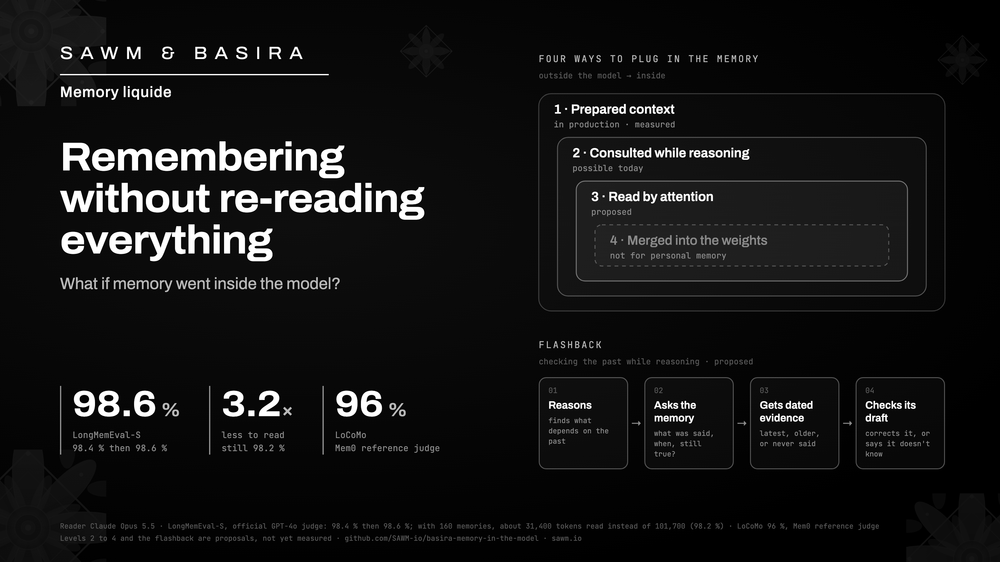

# Plugging a memory into the model: what is measured, what is proposed

*How an AI lab could connect SAWM & Basira Memory liquide to its model, from prepared context all the way to the
attention layers, and what the lab and its customers could gain.*

[Version française](README.fr.md)

## In short

Three words recur throughout this article. A **token** is a piece of a word: 1,000 tokens are about 750 English
words. A **memory** is a piece of information stored by Basira, with its date and its source. **Recall** is the step
where Basira looks for the memories relevant to a question.

- **Results with Claude Opus 5.5.** Basira scores 98.4 % then 98.6 % on LongMemEval-S, and 96 % on LoCoMo, the two
  public reference benchmarks for long-term memory. The two percentages are two successive gradings by the automatic
  judge. Opus reads only what Basira returns.
- **Almost the same score with 3.2 times less to read** (LongMemEval-S). With 160 memories, the model reads about
  31,400 tokens instead of the 101,700 tokens of the full history, and scores 98.2 % then 98.4 %.
- **No language-model tokens for the memory, by default.** Writing and recalling a memory uses a small embedding model
  that runs on a CPU.
- **Four depths of integration**: prepared context, a tool consulted during reasoning, memory read by the attention
  layers, and compressed or learned memory.
- **One memory per user.** By design, recalls for two users do not depend on each other, and memories can be spread
  across as many machines as needed. Our own service has only been measured at small scale (section 7).
- **Flashback and outcome memory (proposed, not yet measured).** During reasoning, the model would check its memory
  for what was said, when, and what has changed since. It would also retrieve what followed its past answers, to better
  anticipate the consequences of the next one.

## 1. The problem

An agent that works with someone for a year accumulates millions of tokens of history. It has three options:

1. **Re-read everything for every question.** This is expensive, slower, and bounded by the model's context window
   (how much text it can read at once, about one million tokens for Opus 5.5). And accuracy drops as the text grows.
   In the paper that introduced LongMemEval, GPT-4o scores 60.6 % with the full history, against 87.0 % when it is
   given only the sessions that contain the answer, selected in advance by the authors. Other studies show the same
   slope: NoLiMa, RULER, Lost in the Middle, Context Rot.
2. **Summarize.** A summary loses the details that will be needed later: a date, an amount, a first name.
3. **Search for passages (RAG).** Everything then depends on the quality of the search, and a failed search is
   invisible: the model answers confidently, without the missing fact.

Basira belongs to the third family, but it is built for an agent's memory. It dates every memory, keeps the earlier
versions of a piece of information, and widens its search when the relevant memory is old.

## 2. What Basira does today

These results are published answer by answer, with a script to recount them:
[basira-longmemeval](https://github.com/SAWM-io/basira-longmemeval) and
[basira-locomo](https://github.com/SAWM-io/basira-locomo).

| Benchmark | Basira recall | What the model reads (median) | Accuracy, two judge passes |
|---|---|---|---|
| LongMemEval-S, 500 questions, official GPT-4o judge | up to 320 memories | ≈ 62,600 tokens | **98.4 % / 98.6 %** |
| LongMemEval-S | up to 160 memories | ≈ 31,400 tokens, for a history of ≈ 101,700 | **98.2 % / 98.4 %** |
| LoCoMo, 1,540 questions, Mem0 reference judge | up to 320 memories | ≈ 18,400 tokens, for a conversation of ≈ 21,800 | **95.97 % / 95.84 %** |

Tokens are counted with the GPT-4o tokenizer; the LongMemEval history is counted as raw text (the LongMemEval paper
reports about 115,000 tokens with a different count). With the strict LongMemEval judge, the LoCoMo answers score
92.08 % then 91.95 %.

LoCoMo conversations are short: at 320 memories, the model still reads 84 % of the conversation in tokens. The
reduction in reading is therefore small there; it matters on long histories. For 95 % of the questions whose evidence
passages are annotated (1,455 of 1,527), Basira returns all of those passages. On a fixed sample of 310 questions, Opus
scores 96.13 % when reading the whole conversation and 94.84 % with the 320-memory recall: the 1.3-point gap is not
statistically significant (p = 0.29), which does not, however, prove equivalence.

On LongMemEval, the breakdown by ability (320-memory recall, pass 1):

| Ability | Correct |
|---|---|
| Recall what the user said | 70/70 |
| Recall what the assistant itself said | 56/56 |
| Track information that changed | 77/78 |
| Reason about dates and the order of events | 130/133 |
| Combine several conversations | 129/133 |
| Say that a piece of information was never given | 29/30 |

Four properties matter to a lab:

- **One memory per user.** Nothing mixes between customers.
- **Every memory is dated and sourced.** Earlier versions of a piece of information stay visible, so the model knows
  which one is the most recent.
- **A memory can be erased on request**, which answers the GDPR right to erasure, without retraining anything.
- **No language model in writing or recall, by default.** A small embedding model on a CPU is enough. Only an optional
  relation extraction uses one; it is off by default and billed separately.

Since 7 November 2026, the Basira API also offers **adaptive recall**: its depth adjusts to the question, from 20 to
320 memories. On LongMemEval, the median context drops to about 26,700 tokens. Its score has not been graded yet; we
will publish it as soon as it is.

## 3. Four ways to plug in the memory

From outside the model to inside it:

| Level | Where the memory lives | What the model sees | What it takes | Status |
|---|---|---|---|---|
| **1. Prepared context** | next to the model | the selected memories, as text, before the question | nothing | in production; this is what our scores measure |
| **2. Tool during reasoning** | next to the model | the memory's answers in the middle of its reasoning | tool calls during reasoning, which already exist | possible today; not yet measured by us |
| **3. Memory read by attention** | inside the inference engine | the precomputed internal states of the selected memories | access to the inference engine; with or without training depending on the technique | proposed |
| **4. Compressed or learned memory** | in a few vectors, or in the weights | memories summarized as vectors, or a memory merged into the model | a bridge to train, or retraining | not recommended for personal memory |

### Level 1: prepared context

This is what produces our scores. Before each answer, Basira selects the relevant memories and gives them to the
model with their dates. The model stays at the end of the chain: it reads and decides. This level works with any
model, and switching models costs nothing.

### Level 2: memory consulted during reasoning

Reasoning models from Anthropic and OpenAI can already call tools in the middle of their reasoning. The memory then
becomes a source the model queries as many times as needed, before it has finished thinking: a first query to get
its bearings, a second to check a date, a third to see whether the information has changed. This level already exists
through a standard connector (MCP). It is the basis of the flashback described in section 4. Each consultation adds
latency, about 3 s today for a deep recall.

### Level 3: memory read by attention

This is the deepest integration. When a model reads text, its attention layers compute an internal state for each
token, kept in GPU memory: the KV cache (keys and values). The idea:

1. **At write time**, the inference engine computes the internal state of each memory and stores it with the memory.
2. **At question time**, Basira selects the memories that are both allowed and relevant: this user's, still valid,
   not erased.
3. **The model receives their internal states** instead of re-reading their text. Two families of published
   techniques make this possible. CacheBlend fuses precomputed states for retrieved passages into attention, without
   training. Memorizing Transformers and LongMem let the model itself look up, in a few layers, the nearest neighbors
   among stored key-value pairs; they require training.

**What it would gain.** Compute: the model no longer redoes the full reading of the memories for every question.
Classic prompt caching helps little here, because the recalled memories change from one question to the next,
whereas a state stored with its memory can be reused across questions.

**What it does not solve.** These states were computed without seeing the question or the other memories, with
positions fixed in advance. The positions must be corrected and a small share of the tokens recomputed (CacheBlend
recomputes about 15 %, according to its authors). Attention between memories is only approximated, which can weigh on
dates and on questions that span several conversations. Quality compared with re-reading the text is not measured.
Once loaded, the states take up GPU memory just as the text would have: this saves compute, not space during
generation.

**What it costs.** Storage. On a public 70-billion-parameter model without KV-cache compression, one token weighs
about 320 KB in 16-bit precision (2 for keys and values × 80 layers × 8 heads × 128 dimensions × 2 bytes). The
101,700-token history of a single user would therefore weigh about 33 GB. The states must be kept on disk or in fast
memory, and only the recalled memories loaded (about 10 GB for 160 memories). That loading may cost as much time as
re-reading the text: this has to be measured. Models designed with a more compact cache cut these figures sharply:
fewer key-value heads (GQA), latent representations (MLA; DeepSeek-V2 reduces its KV cache by 93.3 % compared with
DeepSeek 67B). These choices are made when the model is trained. Finally, the states are specific to one exact version
of the model: switching models, updating the weights or changing the quantization means recomputing everything.

**What it would keep.** The states would be stored memory by memory, under Basira's control. Per-user isolation,
erasure and the source of each memory could therefore be preserved, provided the lab also erases a memory's internal
state when the memory is erased.

This is why the text of the memories remains the source of truth, and their states an accelerator.

### Level 4: compressed or learned memory

Two families of work go even further.

- **Compress each memory into a few vectors** that the model reads instead of the text: a single token per document
  for xRAG, summary tokens for ICAE or gist tokens. Only a small bridge is trained; the model stays as it is. But
  compression loses exact details (dates, figures, first names), which is precisely what memory benchmarks test.
- **Merge the memory into the weights**: key-value memory layers (Memory Layers, Product Keys), memory learned during
  use (Titans, MemoryLLM). This is promising for general knowledge. For a person's memory, it loses what matters:
  safely erasing a specific fact, keeping two users apart, saying where an answer comes from.

**Our recommendation**: keep level 1 as the base, and add levels 2 and 3. Basira holds the truth, with its evidence.
The model consults it during reasoning and, where measurements show it helps, reads the selected memories through
their internal states.

## 4. Flashback: checking the past during reasoning (proposed)

Before answering an important question, a person goes back over what they know: what was said, when, and is it still
true? A flashback would give the model the same reflex:

1. **The model starts reasoning** and spots what, in its answer, depends on the past.
2. **It queries the memory.** For example: "What did the user say about their budget, and when? Does it still hold?"
3. **Basira answers with dated evidence.** It returns the most recent information and its earlier versions, or
   nothing at all if the information was never given.
4. **The model checks its draft against the evidence.** It corrects it, makes it more precise, or says it does not
   know.

In this scheme, the model no longer reconstructs the past from recollection: it answers from dated records. What we
already measure, with the memory read before the answer (level 1), points in that direction: 77 of 78 for information
that changed, 29 of 30 for saying that a piece of information was never given. The flashback itself, with several
consultations during reasoning, is not yet measured: each consultation adds latency, and we do not yet know how much
it improves the answers.

Research points the same way. Having the model check its own claims before answering reduces its errors: on list
questions, the precision of a 65-billion-parameter model rises from 0.17 to 0.36 (Chain-of-Verification, on a task
different from ours). But the model then checks against what it already knows, and the authors note that this
knowledge sets the ceiling. A memory provides exactly the evidence the model does not have. And triggering a search in
the middle of reasoning, when the model is unsure, helps on several hard tasks (Search-o1, with web search).

The flashback also helps prepare what comes next. A good answer takes into account what has already been announced: a
deadline, a rescheduled meeting, a preference that changed. By re-checking the past, the model can account for it and
offer an answer that is more likely to stay right. It does not guess what was never said.

## 5. Consequences: learning from what followed (proposed)

A memory can keep more than what was said. It can keep **what happened next**: the answer given, the action taken,
the user's reaction, the outcome. Before answering, the model would retrieve similar situations and what followed. For
example: "The last time I suggested this supplier, the user reported a late delivery."

It could thus draw on real cases to anticipate the consequences of its answer, and adjust its proposal before making
it. These are analogies, not causes: an isolated case can have other explanations, and the model must not cling to it.
Several lines of work show that the idea holds, each for one part:

- keeping a written record of failures and feedback makes an agent improve from one attempt to the next (Reflexion);
- retrieving similar successful experiences before acting improves the agent (ExpeL, Agent Workflow Memory);
- simulating the next state before choosing an action helps planning (RAP).

We have not found work that connects these three ideas to a dated, per-user memory. If you know of one, we will cite
it.

Basira already recalls what the assistant itself said: 56 of 56 on LongMemEval. Linking each answer to its
consequences, then measuring what that changes in the next answer, is our next step.

## 6. What the lab and its customers could gain

- **High accuracy on long histories.** 98 % on LongMemEval with Opus 5.5. Published scores for a model re-reading the
  whole history are 60 to 64 % for GPT-4o and 76 % for o3, with other judges and other prompts: they are not directly
  comparable to ours. We have not measured Opus 5.5 with the full history, so we do not claim that the memory is more
  accurate than re-reading with that model. Our settings were tuned on LongMemEval; LoCoMo (96 %) is the benchmark they
  were not designed for.
- **GPU capacity.** A conversation's KV cache grows with the length of the context, and it is what limits how many
  conversations a GPU can serve at once. With 3.2 times fewer tokens to read, the part of the cache due to the context
  is 3.2 times smaller while the request is processed (a little less overall, since the instructions, the reasoning
  and the answer add to it). On the public 70-billion-parameter model of section 3, the context goes from about 33 GB
  to 10 GB. This is an order of magnitude on paper, not measured on a serving engine and not transferable to Opus.
  Fewer tokens also means less revenue per call: the argument holds for a provider whose limiting factor is compute.
- **Cheaper when the cache has expired or the history is very long.** At Opus 5.5 pricing ($4 per million input
  tokens), the input cost of a question is about $0.41 when re-reading the whole history without caching, and about
  $0.13 with Basira. But with a warm prompt cache, re-reading the history costs only about $0.02. Basira is cheaper for
  spaced-out conversations (the cache, valid for 5 minutes by default, has expired), for sessions of at most 4
  questions after a cold start, and, even against a warm cache, for histories longer than about 535,000 tokens. These
  costs count input tokens only.
- **Beyond the context window.** Beyond one million tokens, the full history no longer fits in the model. The memory
  can still select memories; we have not yet measured its accuracy on histories longer than those of LongMemEval-S.
- **Trust.** Every answer rests on dated, sourced memories, and a memory can be erased on request.

## 7. Parallel recall, by design

Each user's memory is separate from the others, and a recall reads only the memory of the user concerned. The work of
one recall therefore does not depend on other users' recalls, and capacity grows by adding machines and spreading the
memories across them by user. By design, nothing sets a limit on the number of recalls in parallel. At level 3, the
memories' states would live next to inference, on the lab's own machines.

This has not yet been demonstrated at scale. Our service has been measured up to 4 simultaneous deep recalls, with a
median of about 3.4 s per recall; it still shares some common resources (encoder, storage), and our native engine is
not yet fully parallel. We are working on it, and we will publish a load test with multiple accounts and a gradual
ramp-up.

## 8. What is measured, what is proposed

| Claim | Status |
|---|---|
| 98.4–98.6 % on LongMemEval-S, 98.2–98.4 % with 160 memories (official GPT-4o judge, Opus 5.5) | measured, published answer by answer |
| 96 % on LoCoMo (Mem0 reference judge; 92 % with the strict LongMemEval judge) | measured, published answer by answer |
| 3.2 times fewer tokens read than the full history, for 98.2 % correct answers | measured on LongMemEval-S; Opus 5.5 with the full history not measured |
| No language-model tokens for writing or recall | default configuration; checked in our code |
| Adaptive recall (20 to 320 memories) | in production; score not graded yet |
| Level 2 (memory consulted during reasoning) | possible today; not yet measured by us |
| Level 3 (memory read by attention) | proposed; builds on published techniques; quality and cost to be measured |
| Flashback (checking the past during reasoning) | proposed; not yet measured |
| Outcome memory | proposed; not yet measured |
| Parallel recall | measured up to 4 simultaneous deep recalls; beyond that, load test to come |
| GPU capacity gain | calculation on a public model; not measured on a serving engine |

## 9. References

**Memory benchmarks and context length**
- Wu et al., *LongMemEval: Benchmarking Chat Assistants on Long-Term Interactive Memory*, ICLR 2025. [arXiv:2410.10813](https://arxiv.org/abs/2410.10813)
- Maharana et al., *Evaluating Very Long-Term Conversational Memory of LLM Agents* (LoCoMo), ACL 2024. [arXiv:2402.17753](https://arxiv.org/abs/2402.17753)
- Modarressi et al., *NoLiMa: Long-Context Evaluation Beyond Literal Matching*, 2025. [arXiv:2502.05167](https://arxiv.org/abs/2502.05167)
- Hsieh et al., *RULER: What's the Real Context Size of Your Long-Context Language Models?*, 2024. [arXiv:2404.06654](https://arxiv.org/abs/2404.06654)
- Liu et al., *Lost in the Middle: How Language Models Use Long Contexts*, 2023. [arXiv:2307.03172](https://arxiv.org/abs/2307.03172)
- Chroma, *Context Rot*, 2025. [trychroma.com/research/context-rot](https://www.trychroma.com/research/context-rot)
- Scores of a model re-reading the whole history on LongMemEval-S: [Emergence](https://www.emergence.ai/blog/sota-on-longmemeval-with-rag) (GPT-4o 63.8 %, o3 76.0 %), [Mastra](https://mastra.ai/research/observational-memory) (GPT-4o 60.2 %).

**Memory in attention or in the weights**
- Yao et al., *CacheBlend: Fast Large Language Model Serving for RAG with Cached Knowledge Fusion*, 2024. [arXiv:2405.16444](https://arxiv.org/abs/2405.16444)
- Wu, Rabe, Hutchins, Szegedy, *Memorizing Transformers*, ICLR 2022. [arXiv:2203.08913](https://arxiv.org/abs/2203.08913)
- Wang et al., *Augmenting Language Models with Long-Term Memory* (LongMem), 2023. [arXiv:2306.07174](https://arxiv.org/abs/2306.07174)
- Khandelwal et al., *Generalization through Memorization: Nearest Neighbor Language Models*, ICLR 2020. [arXiv:1911.00172](https://arxiv.org/abs/1911.00172)
- Borgeaud et al., *Improving language models by retrieving from trillions of tokens* (RETRO), ICML 2022. [arXiv:2112.04426](https://arxiv.org/abs/2112.04426)
- Cheng et al., *xRAG: Extreme Context Compression for Retrieval-augmented Generation with One Token*, NeurIPS 2024. [arXiv:2405.13792](https://arxiv.org/abs/2405.13792)
- Ge et al., *In-context Autoencoder for Context Compression in a Large Language Model*, ICLR 2024. [arXiv:2307.06945](https://arxiv.org/abs/2307.06945)
- Mu, Li, Goodman, *Learning to Compress Prompts with Gist Tokens*, NeurIPS 2023. [arXiv:2304.08467](https://arxiv.org/abs/2304.08467)
- Berges et al., *Memory Layers at Scale*, 2024. [arXiv:2412.09764](https://arxiv.org/abs/2412.09764)
- Lample et al., *Large Memory Layers with Product Keys*, NeurIPS 2019. [arXiv:1907.05242](https://arxiv.org/abs/1907.05242)
- Behrouz, Zhong, Mirrokni, *Titans: Learning to Memorize at Test Time*, late 2024. [arXiv:2501.00663](https://arxiv.org/abs/2501.00663)
- Wang et al., *MEMORYLLM: Towards Self-Updatable Large Language Models*, ICML 2024. [arXiv:2402.04624](https://arxiv.org/abs/2402.04624)

**KV-cache size**
- Kwon et al., *Efficient Memory Management for Large Language Model Serving with PagedAttention* (vLLM), SOSP 2023. [arXiv:2309.06180](https://arxiv.org/abs/2309.06180)
- Ainslie et al., *GQA: Training Generalized Multi-Query Transformer Models from Multi-Head Checkpoints*, EMNLP 2023. [arXiv:2305.13245](https://arxiv.org/abs/2305.13245)
- DeepSeek-AI, *DeepSeek-V2: A Strong, Economical, and Efficient Mixture-of-Experts Language Model*, 2024. [arXiv:2405.04434](https://arxiv.org/abs/2405.04434)

**Memory during reasoning, verification, experience**
- Yao et al., *ReAct: Synergizing Reasoning and Acting in Language Models*, ICLR 2023. [arXiv:2210.03629](https://arxiv.org/abs/2210.03629)
- Asai et al., *Self-RAG: Learning to Retrieve, Generate, and Critique through Self-Reflection*, ICLR 2024. [arXiv:2310.11511](https://arxiv.org/abs/2310.11511)
- Dhuliawala et al., *Chain-of-Verification Reduces Hallucination in Large Language Models*, Findings of ACL 2024. [arXiv:2309.11495](https://arxiv.org/abs/2309.11495)
- Li et al., *Search-o1: Agentic Search-Enhanced Large Reasoning Models*, 2025. [arXiv:2501.05366](https://arxiv.org/abs/2501.05366)
- Shinn et al., *Reflexion: Language Agents with Verbal Reinforcement Learning*, NeurIPS 2023. [arXiv:2303.11366](https://arxiv.org/abs/2303.11366)
- Zhao et al., *ExpeL: LLM Agents Are Experiential Learners*, AAAI 2024. [arXiv:2308.10144](https://arxiv.org/abs/2308.10144)
- Wang et al., *Agent Workflow Memory*, 2024. [arXiv:2409.07429](https://arxiv.org/abs/2409.07429)
- Hao et al., *Reasoning with Language Model is Planning with World Model* (RAP), EMNLP 2023. [arXiv:2305.14992](https://arxiv.org/abs/2305.14992)
- Park et al., *Generative Agents: Interactive Simulacra of Human Behavior*, UIST 2023. [arXiv:2304.03442](https://arxiv.org/abs/2304.03442)
- Packer et al., *MemGPT: Towards LLMs as Operating Systems*, 2023. [arXiv:2310.08560](https://arxiv.org/abs/2310.08560)
- Anthropic, documentation on thinking between tool calls (*extended thinking*). [platform.claude.com](https://platform.claude.com/docs/en/build-with-claude/extended-thinking)
- OpenAI, function-calling guide for the o3 and o4-mini models. [developers.openai.com](https://developers.openai.com/cookbook/examples/o-series/o3o4-mini_prompting_guide)

---

[SAWM](https://sawm.io) · SAWM & Basira Memory liquide, memory for AI agents. Get in touch: [sawm.io](https://sawm.io).
